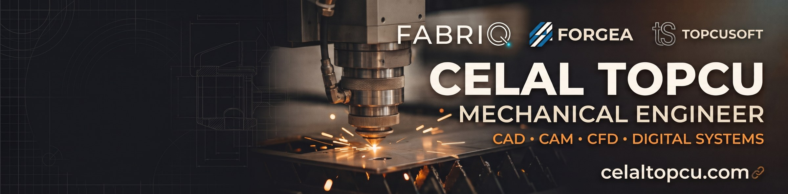

  

# Celal Topcu

Mechanical engineer working across R&amp;D, CFD analysis, mechatronic system design, and manufacturing engineering. Based in Istanbul, Türkiye.

Currently running turnkey greenhouse projects at **Likya Greenhouse Solution**, managing part and tooling design in SolidWorks/DraftSight, and taking an active role on the floor with CNC fiber laser cutting and press operations. Developing specialized software tools to eliminate manual drafting and takeoff overhead in production environments.

---

### 🔨 Systems & Projects

- 🌐 **[celaltopcu.com](https://celaltopcu.com)** — Personal portfolio and technical writings (CFD analysis, aerodynamic datasets for wind turbines, load cell calibration, automated DWG takeoffs).
- 🏭 **[FORGEA](https://forgea.celaltopcu.com)** — Lightweight ERP/MES engineered for sheet metal and structural steel manufacturing (DWG takeoff parsing, sheet nesting, schedule tracking, inventory, and site equipment/services).
- ⚙️ **[UTM (Universal Testing Machine)](https://github.com/Ertuct/UTM)** — Modular, affordable testing machine built from scratch for small-scale material characterization. Python GUI + Arduino Mega firmware.
- 📱 **OptiCut** — Mobile laser cutting parameter calculation and cost estimation utility for shop-floor operators.

---

### 🛠️ Core Competencies

- **Engineering &amp; CAD/CAE:** SolidWorks, DraftSight, ANSYS Fluent (CFD), Structural Analysis, Sheet Metal &amp; Tooling Design
- **Manufacturing &amp; Shop Floor:** CNC Fiber Laser Cutting (Bodor), Hydraulic/Eccentric Presses, Tooling Maintenance, Steel Fabrication
- **Software &amp; Electronics:** Python (FastAPI, NumPy, Matplotlib), TypeScript / React, PostgreSQL, Mechatronics (Arduino, ESP32, Stepper &amp; Load Cell Control)

---

### 📬 Contact &amp; Links

- **Website:** [celaltopcu.com](https://celaltopcu.com)
- **Email:** [contact@celaltopcu.com](mailto:contact@celaltopcu.com)
- **Product:** [forgea.celaltopcu.com](https://forgea.celaltopcu.com)
